# XtremFlow

Application IPTV web auto-hébergée. Un frontend Flutter Web et un serveur Rust natif tiennent dans une seule image Docker. XtremFlow se branche sur un abonnement Xtream Codes et y ajoute un magnétoscope (enregistrements planifiés, enregistrements récurrents), un guide TV avec repli XMLTV et le transcodage FFmpeg à la demande.

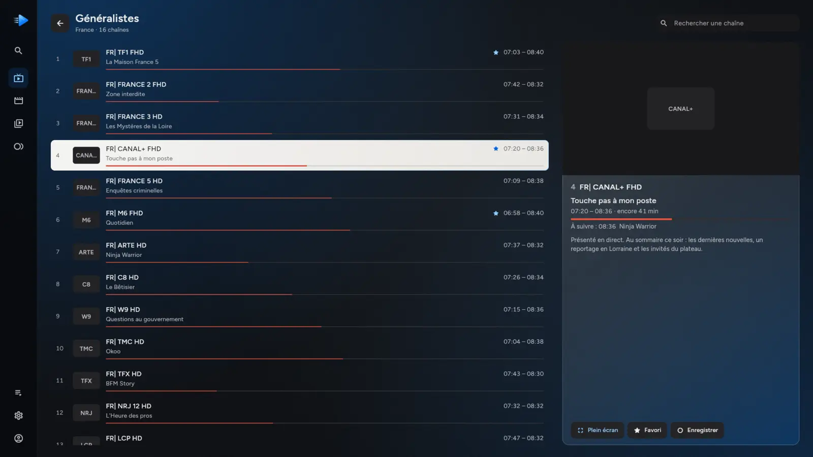

## Captures

Toutes les captures utilisent des données fictives.

| | |
|---|---|
| 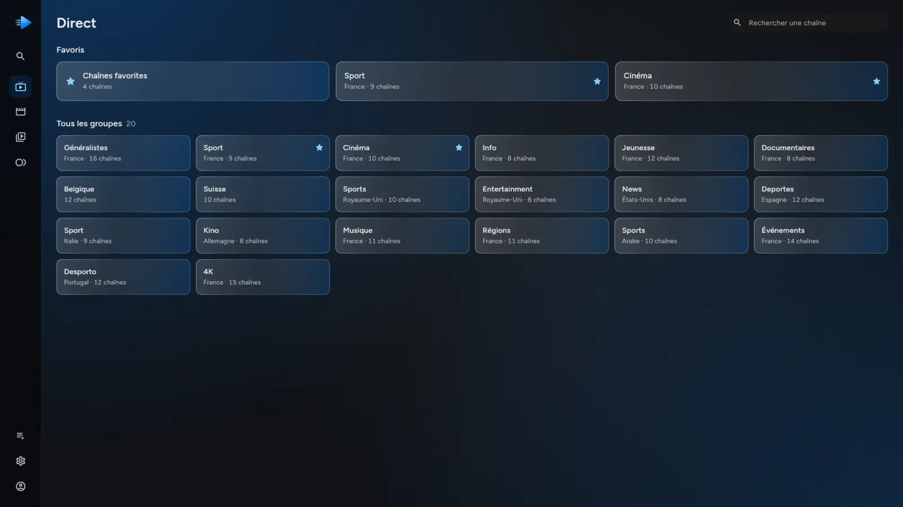 | 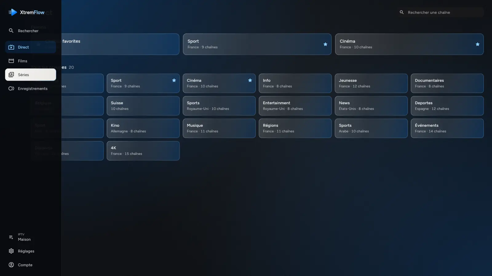 |
| Direct : groupes favoris épinglés, puis tous les groupes | Barre latérale dépliée au survol |
| 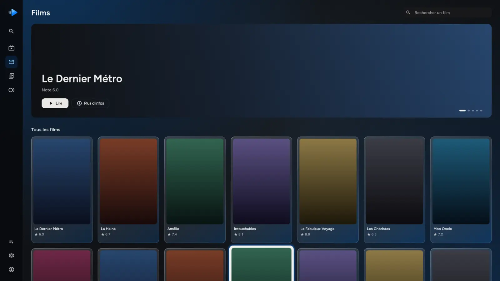 | 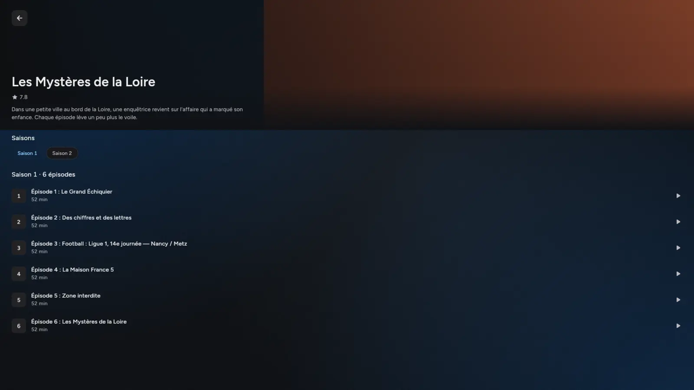 |
| Films : affiche à la une et catalogue | Fiche série : saisons et épisodes |
| 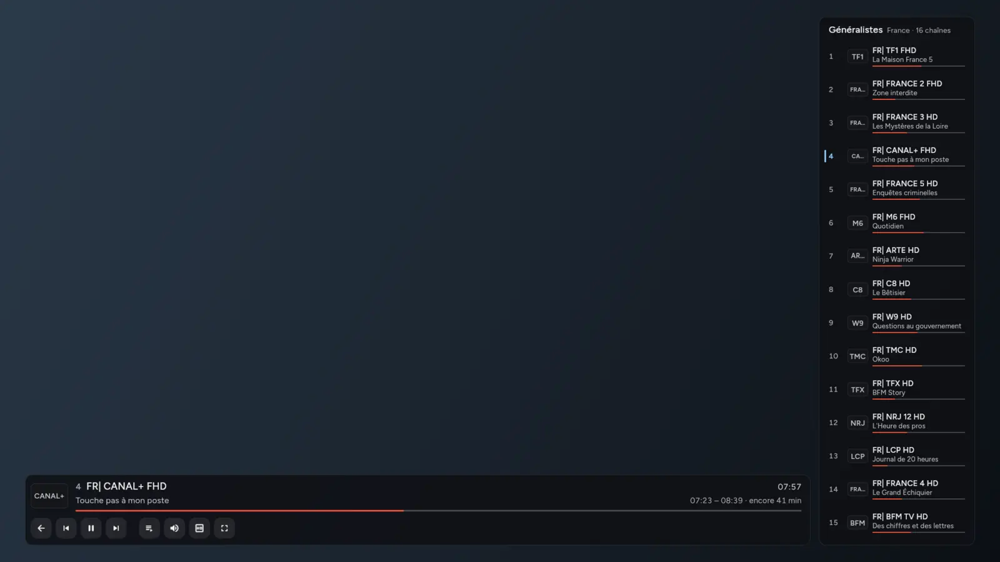 | 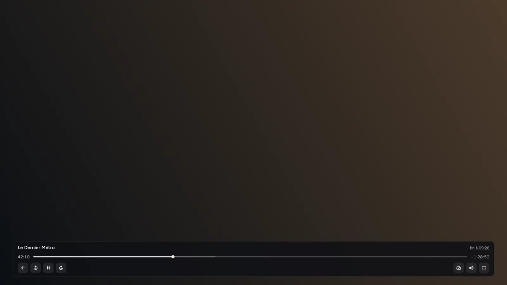 |
| Lecteur en direct, liste des chaînes ouverte (touche C) | Lecteur d'un film : barre de lecture, ±10 s, vitesse |
| 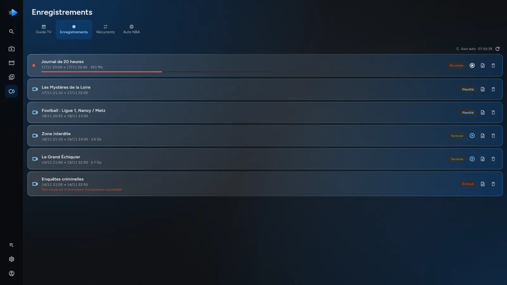 | 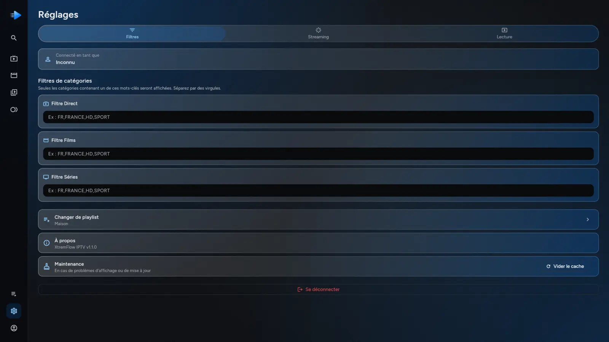 |
| Enregistrements en cours, planifiés, terminés | Réglages : filtres, streaming, lecture |
| 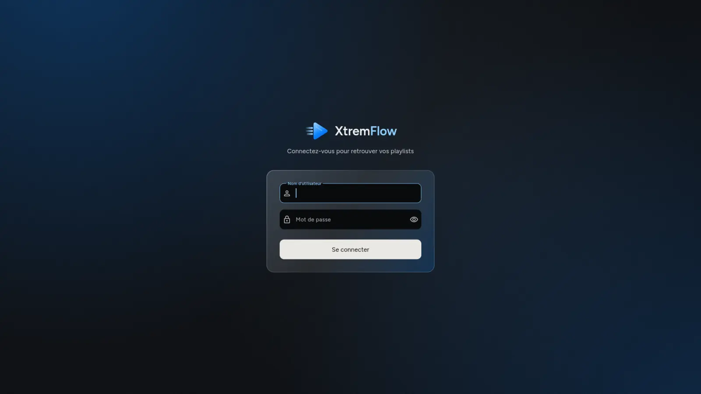 | 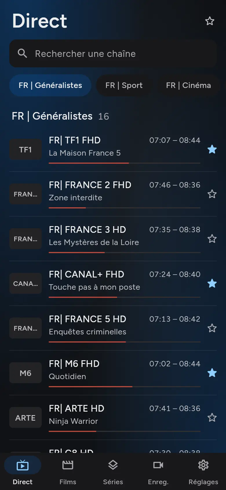 |
| Connexion | Sur téléphone (largeur < 768 px) |

## Fonctionnalités

- Direct, Films et Séries : catalogues Xtream avec catégories, recherche, favoris et reprise de lecture.
- Aperçu vidéo muet dans le Direct : en survolant une chaîne, son image apparaît dans le panneau de droite. L'aperçu utilise une connexion que l'ouverture suivante sur le même compte libère aussitôt, il marche donc aussi avec un abonnement limité à une connexion. Il se coupe en quittant la liste, en cachant l'onglet du navigateur ou après 3 min d'inactivité, et se désactive dans Réglages → Lecture.
- Guide TV : panneau de l'abonné en priorité, repli automatique sur un fichier XMLTV quand le panneau ne se met plus à jour.
- Enregistrements : planification depuis le guide, capture du flux brut en `.ts` avec reconnexion automatique, reprise dans le même fichier après un redémarrage du serveur, conversion en MKV à la fin.
- Enregistrements récurrents : toutes les diffusions d'une émission sont enregistrées (le guide est relu toutes les 4 h).
- Transcodage à la demande : `source | high | medium | low`, en direct comme en VOD. `source` ne transcode rien. NVENC en option.
- Plusieurs utilisateurs : comptes locaux (bcrypt), playlists par utilisateur, panneau d'administration.
- Souris et clavier : un seul élément allumé à la fois, que le focus vienne du survol ou des flèches.

### Raccourcis du lecteur

| Touche | Direct | Film, série, enregistrement |
|---|---|---|
| Espace, K | Lecture / pause | Lecture / pause |
| ← / → | Chaîne précédente / suivante | −10 s / +10 s (Maj : −60 s / +60 s) |
| ↑ / ↓ | Chaîne suivante / précédente | |
| J / L | | −60 s / +60 s |
| 0 à 9 | | Aller à 0 %, 10 %… 90 % |
| , / . | | Ralentir / accélérer |
| C | Ouvrir la liste des chaînes (↑/↓, Entrée pour zapper, Échap pour fermer) | |
| M | Couper le son | Couper le son |
| F | Plein écran | Plein écran |

## Interface

Charte « Salle obscure », commune avec l'application sœur xtremobile : fond graphite, un seul accent bleu, rouge réservé à la progression du programme en cours et à l'enregistrement en cours. Police Figtree embarquée, aucune requête vers Google Fonts. Une barre latérale de 88 px se déplie à 240 px au survol ou quand le focus clavier y entre. Sous 768 px de large, les écrans téléphone prennent le relais avec une barre de navigation en bas.

Le détail (jetons, focus, composants, mouvement) est dans [`DESIGN_SYSTEM.md`](DESIGN_SYSTEM.md).

## Stack

| Couche | Techno |
|---|---|
| Frontend | Flutter Web (Riverpod, GoRouter), lecteurs HTML (hls.js et mpegts.js embarqués) |
| Backend | Rust (tokio, axum, reqwest/rustls, rusqlite), un seul binaire natif |
| Base | SQLite côté serveur (`/app/data/xtremflow.db`) |
| Capture et transcodage | FFmpeg (build BtbN, NVENC inclus) |
| Conteneur | Debian slim multi-stage, port 8089 |

## Démarrage rapide (Docker)

```bash
docker-compose up -d --build
# Application sur http://localhost:8089
```

Au premier démarrage, le serveur crée un compte `admin` avec un mot de passe aléatoire, affiché une seule fois dans les journaux (`docker logs xtremflow`), sauf si `ADMIN_INITIAL_PASSWORD` est défini. Changez-le après la première connexion.

L'image publiée est `ghcr.io/r0m1k3/xtremflow:latest`.

### Variables d'environnement (docker-compose.yml)

| Variable | Défaut | Rôle |
|---|---|---|
| `RECORDINGS_PATH` | `./data/recordings` | Dossier hôte des enregistrements |
| `PUID` / `PGID` | *(utilisateur interne)* | UID/GID du serveur, à aligner sur le propriétaire du dossier d'enregistrement (Unraid : `99` / `100`, comme Plex) |
| `UMASK` | `002` | Droits des fichiers créés (lisibles par tous, groupe en écriture) |
| `TZ` | `Europe/Paris` | Fuseau du conteneur (les enregistrements sont stockés en UTC) |
| `MAX_CONCURRENT_RECORDINGS` | `2` | Enregistrements simultanés |
| `EPG_XMLTV_URLS` | fichiers FR, CH, BE | Sources XMLTV de repli (vide : aucun appel sortant) |
| `NVIDIA_GPU` | `false` | Transcodage NVENC |
| `ADMIN_INITIAL_PASSWORD` | *(généré)* | Mot de passe initial du compte admin |
| `MIN_FREE_DISK_MB` | `500` | Espace libre minimal pour démarrer une capture |
| `RECORDINGS_QUOTA_GB` | `0` (désactivé) | Quota du dossier d'enregistrements (les plus anciens enregistrements terminés partent en premier) |
| `TRUSTED_PROXIES` | *(vide : aucun)* | IP ou plages CIDR (ex. `172.18.0.0/16`) des reverse proxies dont l'en-tête `X-Forwarded-For` est pris en compte, lu de droite à gauche. Vide : le serveur retient l'IP de la connexion |
| `PROXY_ALLOW_PRIVATE_HOSTS` | *(vide)* | Noms d'hôtes du réseau local que le proxy `/api/xtream/` et les captures peuvent joindre malgré la protection anti-SSRF (panneau IPTV local) |

### Reverse proxy et réseau local

- Derrière un reverse proxy (Nginx, Traefik, Caddy…), définissez `TRUSTED_PROXIES` avec l'IP ou le réseau Docker du proxy. Sans cela, tous les clients partagent l'IP du proxy pour la limite de requêtes (600 par minute) et la limite de tentatives de connexion (10 par minute).
- Le proxy `/api/xtream/<url>` et les adresses de flux des enregistrements refusent toute adresse privée, loopback, link-local (métadonnées cloud), CGNAT ou réservée, y compris quand un nom de domaine y mène (contrôle au moment de la connexion). Un panneau IPTV hébergé sur le réseau local doit donc figurer dans `PROXY_ALLOW_PRIVATE_HOSTS`.

## Développement local

```bash
# Frontend (Flutter 3.47)
flutter pub get
flutter analyze && flutter test
node --test "test/web/*_test.mjs"   # tests du lecteur JS
flutter run -d chrome               # nécessite le backend pour les routes /api

# Backend (Rust ≥ 1.98)
cd server
cargo test
cargo clippy -- -D warnings
XTREMFLOW_DB_PATH=./dev.db cargo run -- --port 8089 --path ../build/web
```

`XTREMFLOW_DB_PATH` (défaut `/app/data/xtremflow.db`) et `RECORDINGS_DIR` (défaut `/app/recordings`) permettent de lancer le serveur hors conteneur. La base SQLite est compatible avec celle de l'ancien serveur Dart : schéma, migrations et formats de date sont identiques, une base existante est reprise telle quelle.

Le build Windows natif est documenté dans [`BUILD.md`](BUILD.md).

## Structure du projet

```
server/                 Serveur Rust (crate xtremflow-server)
└── src/
    ├── main.rs         Démarrage, arrêt propre (SIGTERM : clôture des enregistrements)
    ├── server.rs       Middlewares (journaux masqués, sécurité, rate limit, CORS) et routage
    ├── api/            Handlers HTTP (auth, playlists, enregistrements, EPG, proxy, streaming…)
    ├── services/       Planificateur d'enregistrements, sessions FFmpeg, XMLTV, logos
    ├── db.rs           SQLite (schéma, migrations)
    └── util/           Masquage des identifiants, chemins sûrs, mots de passe, ffprobe

lib/                    Frontend Flutter
├── core/               Modèles, thème, widgets partagés, router, clients API
├── features/           auth / admin / iptv (ordinateur)
└── mobile/             Écrans téléphone

web/                    Lecteurs HTML + bibliothèques embarquées (hls.js, mpegts.js)
docs/screenshots/       Captures de ce README
```

## Sécurité

- Mots de passe en bcrypt (les anciens hashes sont convertis à la connexion suivante).
- Les identifiants Xtream ne quittent jamais le serveur : la passerelle `/api/xtream-api` et le proxy `/api/xtream` (réservé aux sessions ouvertes) les ajoutent côté serveur.
- Identifiants masqués dans tous les journaux. Protection anti-SSRF, redirections comprises.
- Cookie de session HttpOnly, limite globale de requêtes et limite de tentatives de connexion par IP.

## CI et publication

`ci.yml` (analyse, tests Flutter, JS et Rust, build web et backend) tourne sur chaque PR et chaque push sur main. `docker-publish.yml` publie `ghcr.io/r0m1k3/xtremflow:latest` seulement après une CI verte sur main.

## Dépannage

- Journaux : `docker logs xtremflow` (les URL y sont masquées).
- Mot de passe admin perdu : supprimer le volume `xtremflow-data` recrée la base et affiche un nouveau mot de passe. Attention, cela efface aussi les utilisateurs et l'historique des enregistrements.
- Guide TV vide : vérifier `EPG_XMLTV_URLS` et que la chaîne a un `epg_channel_id`. L'en-tête `X-Epg-Source` des réponses `/api/epg/<id>` indique la source utilisée.
- Enregistrement échoué : bouton « Logs » sur la ligne de l'enregistrement ; la raison (`error_reason`) s'affiche sous le titre.
- Aperçu du Direct qui ne démarre pas : après un échec, il reste coupé 60 s (logo et programme seulement). Vérifier aussi le réglage « Aperçu vidéo dans le Direct ».

## Licence

Propriétaire, usage privé uniquement.
